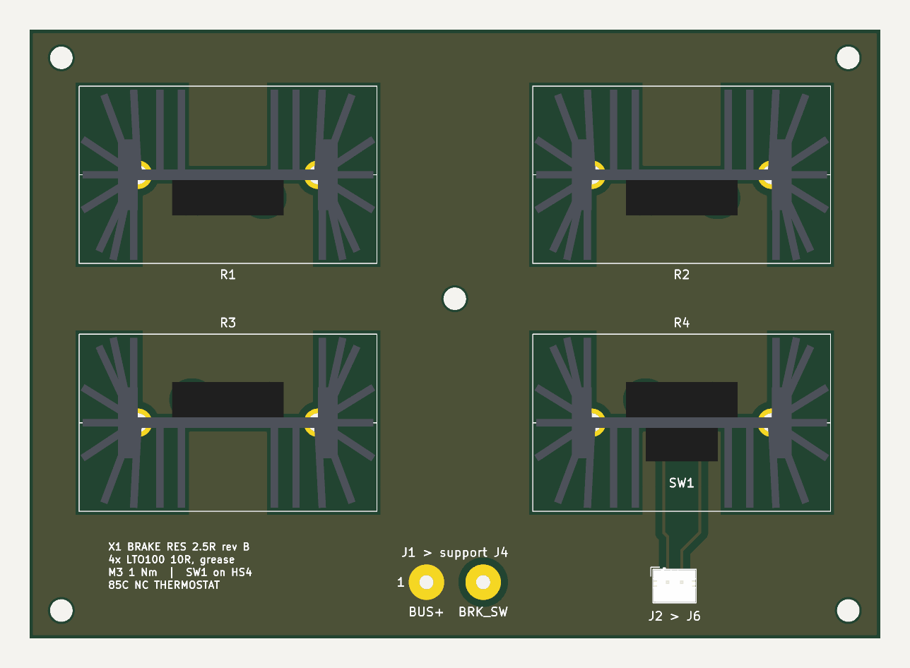

# X1 brake resistor board (rev B)

The 2.5 ohm load for the support board's brake chopper (Q3, on at 57.1 V,
off at 55.0 V). It replaces the 2026-10 BrakeResistor draft in
`source/external_boards/BrakeResistor` on the X1 working branch. That draft
had four bare LTO100s along one edge, waiting for an unspecified "common
vertical heatsink". This revision adds a heatsink per resistor, a thermostat,
and a modeled thermal envelope.

## What it is

| | |
|---|---|
| Bank | 4 x Vishay LTO100 10 ohm in parallel = 2.5 ohm (same value the support board and system model assume) |
| Cooling | Each resistor screwed to its own Ohmite RA-T2X-64E board-level heatsink (3.1 C/W natural), with silicone grease |
| Thermostat | Sensata Airpax 67L085P, normally closed, opens at 85 +/- 5 C. Its bracket is plastic, so it is isolated. It shares R4's M3 screw on the far face of HS4's web. |
| J1 | Two 2.0 mm wire pads, 8 mm pitch, the same land as support J4. 1 = BUS+, 2 = BRK_SW. Use a 16 AWG pair. |
| J2 | JST PH 2-pin to support J6 (PH to PH lead). 1 = TH_OPEN, 2 = support GND. |
| PCB | 120 x 86 mm, 2 layers, 1.6 mm, 1 oz nominal. BUS+ is a plane on top and BRK_SW a plane on the bottom, so the chopper loop is two parallel plates. |
| Cost | About $62 in parts for one board at qty 1 (see [bom.csv](bom.csv); all in stock at DigiKey on 2026-11-02) plus the PCB |

Mount the board flat with the heatsink fins vertical. The heatsink columns
are 64 mm apart, leaving a nominal 22 mm gap. The power-wire pads are
centered on the long axis. The five M3 holes support the board at the corners
and between the sinks, which weigh about 250 g together.

## Rating and how it was sized

[brake_sizing.py](brake_sizing.py) computes everything below. Its output is in
[checks/brake_sizing-output.txt](checks/brake_sizing-output.txt).

The chopper puts 1.3 kW across the bank while it conducts. Each burst lasts
only about 0.17 ms (52 mJ per resistor, 5 % of the LTO100 cold single-pulse
limit). Averaged over time, the bank dissipates the regenerated power and no
more. So the 1.3 kW figure does not size anything. What sizes the bank is:

- **Continuous: 41 W average at 40 C ambient** (61 W at 25 C). That is the
  power at which the heatsinks reach 80 C, the lowest point at which the
  thermostat may open. The resistors are well inside their rating there:
  case 90 C, element 106 C. The LTO100 would allow 56 W each at that case
  temperature.
- **Events: limited by the resistor element, not the heatsink.** The LTO100's
  thick-film element has very little thermal mass. With the bank already at
  its continuous rating:

  | Event energy | Highest bank power | Shortest duration |
  |---|---|---|
  | 25 J | 664 W | 0.04 s |
  | 50 J | 370 W | 0.14 s |
  | 100 J | 251 W | 0.40 s |
  | 150 J | 203 W | 0.74 s |
  | 300 J | 154 W | 1.95 s |

  A cold bank takes roughly twice these powers.

Regen profiles checked (all assumptions, none measured):

| Case | Profile | Load | Result |
|---|---|---|---|
| A1 | P96 arm, lift6 cycle from the system model: 28 J every 3.5 s | 8 W avg | fits |
| A2 | P96 arm, fast pick-and-place: J1 and J2 each lower 6 kg at 3 rad/s (GIM8115 limit about 3.8 rad/s at 48 V), 70 W each for 0.52 s, every 2 s | 36 W avg | fits, sinks 76 C |
| A3 | P96 gates-off fall, J1+J2+J4 (brake-resistor-check-20261025.md), starting hot from A2 | 140 J in 0.65 s | fits, element 160 C |
| A4 | P96 arm e-stop from speed, starting hot from A2 | about 30 J in 0.1 s | fits |
| W1 | 3 x WGG8108-8, gait-like braking: each 160 W for 0.1 s per 1 s step, two in phase | 32 W avg | fits |
| W2 | 3 x WGG8108-8 stopped from 819 rpm (Kv x 50.4 V) at the full 1.3 kW chopper rate: 106 J of rotor energy plus the 50 J `regen_event_j` target | 156 J in 0.12 s | **too hot**. It fits if firmware caps total regen at about 200 W, which is a 0.75 s stop. |
| W3 | 1 x WGG8108-8 braking continuously at its nominal 10.2 Nm and 390 rpm (a dyno or winch load) | 341 W avg | **not supported** by any passive board this size |
| F1 | Support-board forced discharge when RUN opens: 3 mF from 54 V | 5 J | fits |

Assumptions:
- GIM8115/GIM8108 data from `system_model/openarm_params.m`.
- The WGG8108-8 is taken at its 24 V catalog data. Rotor inertia is unpublished, so 1.5e-4 kg m2 is assumed.
- Gear efficiency 0.9 (0.85 for WGG). All regen goes to the brake, with nothing credited to the supply (requirements.json).
- 40 C ambient.
- Heatsink rise is read off Ohmite's curve and derated 15 % for four sinks in a 2 x 2 block.
- The LTO100 transient impedance is fitted to Vishay's energy curve, conservatively at 0.2 s.

## What this needs from the rest of the system

1. **Firmware must cap regen power.** The table above is the contract. Hard
   stops of the WGG motors from high speed are the case that breaks it. Above
   about 650 W total for more than about 40 ms, an LTO100 element overheats,
   and thick film usually fails open. With the bank open, the next regen
   event takes the bus past the 80 V parts.
2. **The thermostat does not stop regen** (pushing back on the support-board
   design here). On the support board an open J6 only blocks the forced
   discharge (Q6). If the average regen stays above 41 W, the heatsinks keep
   heating with the thermostat open. TH_OPEN should also reach the
   controllers so they stop regenerating, or drop RUN.
3. **A source above 57.1 V would burn the bank.** The LM5069 overvoltage
   lockout lets the source back on below 57.6 V. That is above the 57.1 V
   chopper threshold, so a supply set to about 57.2-59 V (a misset bench PSU,
   for example) holds the chopper on at 1.3 kW. From hot the bank survives
   about 6 ms of that. Either move the OVLO re-enable below 55 V or add a
   maximum on-time or duty limit to the chopper. This is a support-board
   change, so it is not made here.
4. If the WGG application really needs sustained braking (W3), cooling is the
   lever: Ohmite rates the same sink at 1.0 C/W in 200 LFM of air, about three
   times the continuous rating. The other option is an aluminium-housed
   wirewound resistor on a plate. Those have far more thermal mass for events,
   for example a single Yageo AHA50AFB-2R5 or Ohmite HS50 2R5 (both in stock).

## Open items

- The resistor and thermostat now use 3.0 mm and 1.8 mm round plated holes.
  Dry-fit HS4, its resistor, the thermostat and the shared fastener before
  soldering. Check lead shoulder clearance, clamping and insulation.
- Front-side copper keepouts follow the nominal metal base profiles with
  margin. Check the as-built sink-to-pad clearance and verify insulation
  around the floating sink pins. The 3D models are simplified envelopes.
- Enclosure airflow, thermal behavior and the support-board interlock
  remain to be verified. Fabricator DFM and first-article fit are open.

## Files

- `generate.py`: writes the footprints, schematic and routed board. Run it with KiCad's Python:
  `"%LOCALAPPDATA%/Programs/KiCad/10.0/bin/python.exe" generate.py --layout-only`
  rebuilds the layout while preserving the existing schematic and project
  settings.
- `BrakeResistor/`: KiCad 10 project.
- `BrakeResistor.pretty/`: land patterns for LTO100 on the sink, 67L on the sink web, and the wire pads.
- `fab/` contains the superseded **98 x 86 mm** exports. For the current
  outline and round drills, see the [120 x 86 mm review exports](../../build/brake-resistor/length-20261104/notes.md).
- `checks/` contains the current KiCad 10.0.7 ERC and DRC reports. ERC, DRC,
  unrouted connections and schematic parity issues are all zero.
